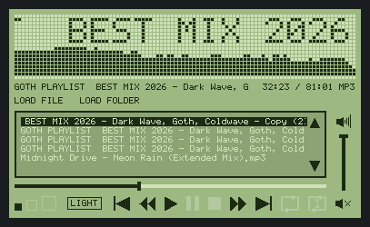
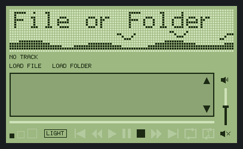
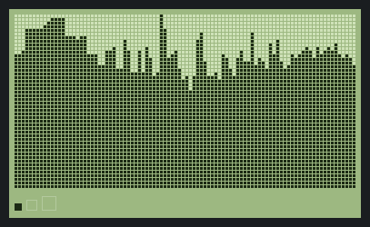
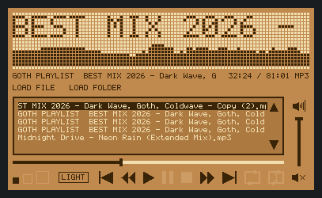
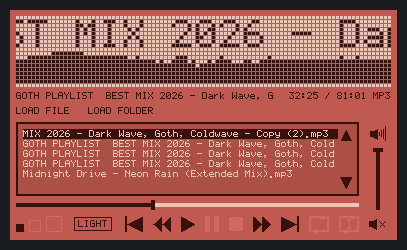

# vibeamp

A native Windows desktop music player, written in Odin against the Win32 API.
No runtime, no installer, no external DLLs: one `.exe` that opens instantly and
plays MP3s.

Current state: **v1.0** — a double-height LCD matrix: the title marquee on top,
a live spectrum analyzer under it, then the track info, a scrub bar, the LOAD
controls, a framed playlist, a clickable transport and a vertical volume column.
Four LCD palettes, a full-window spectrum view, sessions remembered between runs,
and only one instance at a time.



> Maintainers: [`HANDOVER.md`](HANDOVER.md) has the architecture, the constraints
> the code depends on, and the history behind the design decisions.

## Requirements

- [Odin](https://odin-lang.org/) (built and tested with `dev-2026-11-nightly`)
- Visual Studio Build Tools with the C++ workload (Odin uses the MSVC linker)
- The Windows SDK's `rc.exe` (comes with the C++ workload) — the build compiles
  `res/app.rc`, which embeds the application icon and the version metadata

MP3 decoding and audio output come from **miniaudio**, which ships with Odin as
`vendor:miniaudio` and is linked statically — nothing to install.

## Build

```bat
build.bat            :: debug build
build.bat release    :: optimized build
```

The executable is written to `bin\vibeamp.exe`.

If `odin` is not on your `PATH`, set it first:

```bat
set ODIN=F:\bin\odin-windows-amd64-dev-2026-11a\dist\odin.exe
build.bat release
```

## Using it

Click anything in the panel. Everything also has a keyboard shortcut:

| Control | Action | Key |
|---|---|---|
| `LOAD FILE` | pick one MP3 and play it | `Ctrl+O` |
| `LOAD FOLDER` | pick a folder; every `*.mp3` in it becomes the playlist | `Ctrl+F` |
| size gauge | switch between 1x / 2x / 4x | `=` and `-` |
| `LIGHT` button | cycle the LCD palette: green → amber → red → grey | `C` |
| spectrum rows | expand the analyzer to the whole panel; click again (or `Esc`) to go back | |
| seek bar | click to jump, drag to scrub through the track | |
| volume slider | click or drag to set the level (also unmutes) | |
| mute button | toggle mute | |
| prev / next | previous / next track | `Up` / `Down` |
| rewind / forward | seek 5 seconds back / forward | `Left` / `Right` |
| play / pause | start or resume / pause (pause flashes) | `Space` |
| stop | stop and rewind to 0:00 | `S` |
| loop all | loop the whole playlist on / off | `L` |
| loop 1 | loop the current track on / off | `Ctrl+L` |
| mute | toggle mute | `M` |
| volume | up / down in 5% steps (comes off mute) | `Page Up` / `Page Down` |

Loop modes are independent: **off** plays to the end of the last track and
stops, **loop all** wraps to the first track, **loop 1** repeats the current
track.



## The LCD panel

One panel, one 2 px bezel, six bands:

1. **Matrix** — 18 dot rows: a blank row at the top, 8 for the scrolling title,
   8 for the spectrum analyzer, and a blank row at the bottom, so the content
   never touches the bezel. Dots are 3x3 px with a 1 px gap (4 px pitch), which
   fits **94 columns** at every size step. Clicking the analyzer's own rows
   swaps the panel for the full-window spectrum view — the matrix then fills
   everything the other bands used (about 48 rows at 1x) with only the size dots
   left at the bottom; clicking it again, or `Esc`, returns.
2. **Info** — file name on the left, `0:28 / 2:12 MP3` on the right.
3. **Load** — `LOAD FILE` and `LOAD FOLDER`.
4. **Playlist** — a dark 2 px frame with a 5 px buffer, on a darker green than
   the panel, showing 6 entries at a time with LCD up/down arrows on the right.
   One click on an arrow scrolls exactly one line; clicking a track plays it
   from the start. The playing track gets a dark bar so its light text stands
   out, and the view scrolls itself to keep that row visible. Prev/next always
   wrap around the list, regardless of the loop mode. If the playing row's name
   is wider than the pane it slowly scrolls left, wrapping round after a gap;
   the other rows are simply clipped.
5. **Seek** — a 4 px progress line in a 10 px band, sitting between the playlist
   and the transport. Unheard is drawn in the unlit dot colour, played in the
   ink colour, with a 4x10 px thumb on the boundary. Click anywhere to jump, or
   drag the thumb: the bar follows the pointer and the time readout follows the
   bar. One pixel of the line is one seek step.
6. **Icons** — size gauge, a bordered `LIGHT` button that cycles the palette
   (same font and size as the load controls), then prev, rewind, play, pause,
   stop, forward, next, loop, loop 1. Every icon is 16 px tall and sits on one
   baseline; the gauge squares are 8/12/16 px, bottom aligned, so the largest
   matches the icon height.
7. **Volume** — a column down the right side, from the playlist top to the
   bottom of the icon row, anchored on the mute button: the mute sits one icon
   gap after the transport, and the speaker and slider are centred on it. The
   speaker shows the level as sound waves — one per third of the range, plus a
   taller wave at full volume — and is a readout, not a button. The slider is
   the seek bar rotated (ink below the level, unlit above, 10x4 thumb); clicking
   or dragging it sets the level and unmutes. Only the bottom mute button
   toggles mute.

Icons are crisp geometry (`FillRect` and `Polygon`), not dots, so they read as
LCD segments rather than as pixel art.

The client area is **407x250**. The panel is inset by a 10 px margin of window
background, and the dot field is inset a further 6 px inside the bezel (a 2 px
bezel plus 4 px of green padding), so the display reads as a screen set into a
case rather than filling the window edge to edge.



## The spectrum analyzer

The audio device callback taps every sample it writes: a mono mix is pushed
into an 8192-sample ring buffer. Each frame the UI takes the newest 2048
samples, applies a Hann window, runs a radix-2 FFT, and folds the bins into one
bar per column on a log axis from 40 Hz to 16 kHz.

The dB scale (`-85` to `-18 dB`), an instant attack with a ~1.6 units/second
fall, and a **+21 dB tilt across the band** turn per-bin levels into a readable
shape: music rolls off with frequency, so without the tilt the right half of the
display stays dark.

Verified against a white-noise probe: flat bars across every column, with a
1 kHz tone spiking exactly one column. `tests/fft_test.odin` checks the FFT
itself (`odin run tests/fft_test.odin -file`).

The bars follow the **output level**, so the display behaves like an output
meter: they scale linearly with the volume slider and go flat when muted. While
a track is loaded there is always at least one lit row, so mute reads as a flat
line along the bottom rather than an empty panel; with nothing playing the idle
scene takes over instead.

## The idle animation

Until something is loaded there is no signal to analyze, so the same eight rows
show a looping scene instead: two out-of-phase sine waves rolling the sea
surface, and three birds crossing it, flapping. It is entirely procedural —
a sine or two per lit dot, no assets — and gives the panel something alive to
show on first launch.

`src/idle.odin` holds it. The scene runs at 20 fps and comes back three seconds
after playback is paused or stopped — long enough that a brief pause doesn't
flicker it on, short enough that a stopped player doesn't sit on dead bars.
Resuming playback replaces it with the spectrum immediately.

## What is remembered

State lives in a plain UTF-8 key/value file:

```
%LOCALAPPDATA%\vibeamp\settings.ini
```

`%LOCALAPPDATA%` rather than `%APPDATA%`: music paths and playback positions are
machine-specific, so roaming them between machines buys nothing.

| Key | Meaning |
|---|---|
| `scale` | window size step (1x / 2x / 4x) |
| `theme` | LCD palette index |
| `volume` | level, 0–100 (defaults to 50 when absent) |
| `muted` | 0 or 1 |
| `mode` | `folder`, `single` or `none` |
| `folder_dir` | last `LOAD FOLDER` choice |
| `file_dir` | folder of the last `LOAD FILE` choice — tracked separately |
| `playlist_dir` | folder that was actually loaded, for restoring |
| `last_track` | full path of the playing track |
| `position` | seconds into that track |

The two dialog folders are independent: picking a folder and picking a file each
remember their own starting place.

**Restoring.** On launch the app reopens the playlist (rescanning the folder, or
the single file), finds the remembered track *by path*, and parks there **paused**
at the saved position. It does not start playing on its own.

**Missing files.** If the remembered track has been deleted or moved, the app
falls back to the `Select File or Folder` marquee and stays silent — no dialog,
no error. A folder playlist that still exists is still restored, so the
remaining tracks are there to pick from. A saved position past the end of a
changed file is clamped near the end.

**When it saves.** Every 5 seconds while playing, and immediately on pause,
stop, track change and exit. Writes go to `settings.ini.tmp` first and are then
moved over the real file, so a kill mid-write cannot truncate the config.

**One instance at a time.** A named mutex (`Local\vibeamp-single-instance`) is
held for the life of the process. A second launch shows *"vibeamp is already
running."* and exits without touching the settings.

## Colours

Four palettes, cycled with the `COLOR` control and remembered between runs.
Each keeps the same relationships: a mid panel, lighter unlit dots, a ghost just
above the panel, near-black lit dots, and a playlist infill just below the panel.

| Theme | Panel | Unlit | Ghost | Lit | Playlist |
|---|---|---|---|---|---|
| Green | `#9DB881` | `#CFE2B8` | `#B3C99E` | `#1C2A14` | `#8CA474` |
| Amber | `#C08A4E` | `#F0DDB0` | `#CD9C65` | `#3A2408` | `#AC7940` |
| Red | `#C05A50` | `#F0C2B6` | `#CE6A5E` | `#3A100C` | `#AC4F45` |
| Grey | `#A9AFB2` | `#DEE3E5` | `#C1C7CA` | `#1E2225` | `#949A9D` |

The window background stays `#1A1D20` in every theme.





## Code map

| File | Contents |
|---|---|
| `src/main.odin` | window, layout, painting, hit-testing, transport state |
| `src/audio.odin` | miniaudio device + decoder, the sample tap, atomics |
| `src/spectrum.odin` | window, FFT, band mapping, smoothing |
| `src/idle.odin` | the sea-and-birds idle scene |
| `src/library.odin` | playlist, folder scanning, the two file dialogs |
| `src/settings.odin` | the settings file, restore helpers, single instance |
| `res/app.rc`, `res/vibeamp.ico` | the application icon resource |

**Layout and hit-testing share one function.** `build_layout()` computes every
rectangle once; painting draws from that struct and clicks test against rects in
the same struct, so a control can never be drawn in one place and clickable in
another.

**Threading.** The audio callback runs on miniaudio's thread and only touches
the decoder, atomics and the ring buffer. Loading a track stops the device
before swapping the decoder, so the audio thread never sees a half-initialised
stream. Seeking is a request the callback performs.

## Notes

- **No console.** Built as a GUI subsystem binary.
- **Repaints only on change** — when the marquee advances a column, a bar height
  changes, the flash toggles, or the clock ticks. Analysis and painting are
  capped at 30 fps; the 60 Hz timer is twice what the display needs.
- **Dirty bands.** The back buffer persists between frames, so a paint redraws
  only the bands that changed — the matrix, the clock line, the scrolling
  playlist row — and blits. That plus batched drawing keeps playback at single
  digit CPU.
- **Batched drawing.** The dot field is a GDI pattern brush, so the unlit grid
  is one fill and each column's lit run is one more; text rows are drawn one
  fill per horizontal run of pixels. That took the full-window spectrum from
  ~21% of a core to ~4%.
- **Double buffered** through a memory DC, so nothing flickers.
- **Font.** A 5x7 bitmap font covering ASCII letters, digits and common
  punctuation. Other characters render as `?`.
- **Dark title bar** via `DwmSetWindowAttribute`.
- **COM is initialised on the UI thread.** The folder picker is a shell COM
  object; without `CoInitializeEx(APARTMENTTHREADED)` `SHBrowseForFolderW`
  creates an *invisible* dialog and the modal loop hangs the app forever. The
  file dialog does not need COM, which is why only "Load Folder" was affected.
- **The icon is a real Windows resource.** `res/vibeamp.ico` holds five sizes
  (16–256 px); `res/app.rc` declares it as resource ID 1; the build passes
  `-resource:res\app.rc`, which Odin hands to `rc.exe`. Explorer, the taskbar
  and the title bar all read it from the PE, and the window class loads the same
  ID so the small title-bar icon matches. Without the resource Windows shows its
  generic application icon.
- **The version is in two places on purpose.** `res/app.rc` carries a
  `VERSIONINFO` block that Explorer's Properties → Details reads out of the PE,
  and `APP_VERSION` in `src/main.odin` feeds the title bar, since the app has no
  About box. Bump both when releasing.

## Known gaps

- The marquee shows the loaded track's file name; there is no separate ID3 tag
  reading.
- Non-ASCII file names are not covered by the font.
- Track changes reload the stream (no gapless switching).
- No volume or mute yet.

## Roadmap

1. **Volume / mute** with LCD indicators.
2. **Seek bar** across the panel width.
3. **ID3 tags** on the info line instead of the file name.


